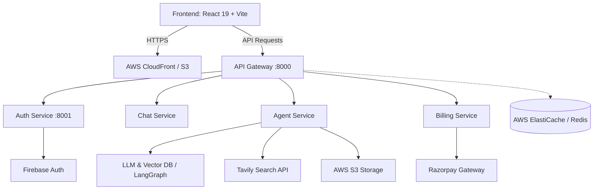

# Cortex AI 🧠⚡

An enterprise-grade, microservice-based AI orchestration platform that delivers multi-modal AI capabilities, coding sandboxes, document analysis (PDF/PPT), and web search via intelligent agents.

---

## 🌟 Key Features

- **🤖 Multi-Agent Architecture**:
  - **Coding Agent**: Interactive code generation, debugging, and live editing via Monaco Editor.
  - **Document & PDF RAG Agent**: Retrieval-Augmented Generation for semantic document querying.
  - **PPT & Presentation Agent**: Automated slide generation and presentation workflows.
  - **Vision & Image Analyzer**: Multi-modal visual inspection and comprehension.
  - **Web Search Agent**: Real-time web intelligence powered by Tavily.
- **⚡ Microservices Backend**: Decoupled, horizontally scalable Node.js services with API Gateway routing and Redis caching.
- **🔐 Secure Authentication**: Firebase Authentication paired with role-based access control.
- **💳 Billing & Credits**: Integrated Razorpay payment gateway and credit-deduction management.
- **🚀 Automated CI/CD Pipeline**: Continuous deployment to AWS ECS (backend containers) and S3 + CloudFront (frontend SPA) via GitHub Actions.

---

## 🏗️ Architecture Overview



---

## 📂 Project Structure

```
Cortex AI/
├── .github/
│   └── workflows/
│       └── deploy.yml          # GitHub Actions deployment to AWS ECS & S3
├── backend/
│   ├── docker-compose.yml      # Local development stack (Redis, etc.)
│   ├── gateway/                # API Gateway & Reverse Proxy
│   ├── services/
│   │   ├── agent/              # LangGraph AI Agents, RAG & Tool Orchestration
│   │   ├── auth/               # User Authentication & Firebase Admin
│   │   ├── billing/            # Plans, Subscriptions & Razorpay Processing
│   │   └── chat/               # Conversations & Messaging
│   └── shared/                 # Common modules (Redis, configs, helpers)
└── frontend/                   # Modern React 19 + Tailwind CSS + Vite SPA
```

---

## 🛠️ Tech Stack

### Frontend
- **Framework**: React 19, Vite
- **Styling**: Tailwind CSS v4, Motion (Framer Motion)
- **State Management**: Redux Toolkit
- **Code Editor**: Monaco Editor
- **Icons & Markdown**: Lucide React, React Icons, React Markdown

### Backend & Services
- **Runtime**: Node.js (ES Modules), Express.js
- **Orchestration**: LangGraph, LangChain
- **Database & Cache**: MongoDB, Redis (AWS ElastiCache)
- **Storage**: AWS S3
- **Authentication**: Firebase Authentication & Firebase Admin SDK
- **Payments**: Razorpay SDK

### DevOps & Cloud Infrastructure
- **Containers**: Docker, Docker Compose
- **Container Registry**: AWS ECR
- **Compute**: AWS ECS (Elastic Container Service)
- **Hosting & CDN**: AWS S3, AWS CloudFront
- **CI/CD**: GitHub Actions

---

## 🚀 Getting Started

### Prerequisites
- [Node.js](https://nodejs.org/) (v20+)
- [Docker](https://www.docker.com/) & Docker Compose
- AWS CLI configured (for deployment)

### 1. Clone the Repository
```bash
git clone https://github.com/RaghavD-hub/CortexAI.git
cd CortexAI
```

### 2. Environment Variables Configuration
Create `.env` files in each service directory following `.env.example` templates:

- **Root / Backend Services**:
  - `backend/gateway/.env`
  - `backend/services/auth/.env`
  - `backend/services/agent/.env`
  - `backend/services/billing/.env`
  - `backend/services/chat/.env`
- **Frontend**:
  - `frontend/.env`

### 3. Local Development

#### Start Redis:
```bash
cd backend
docker-compose up -d
```

#### Run Backend Services:
In separate terminal tabs, install and start each microservice:
```bash
# Gateway
cd backend/gateway && npm install && npm start

# Services (Auth, Agent, Chat, Billing)
cd backend/services/auth && npm install && npm start
cd backend/services/agent && npm install && npm start
cd backend/services/chat && npm install && npm start
cd backend/services/billing && npm install && npm start
```

#### Run Frontend:
```bash
cd frontend
npm install
npm run dev
```

---

## 🚢 Deployment

Deployments are automated through **GitHub Actions** ([deploy.yml](.github/workflows/deploy.yml)).

Every push to `main` triggers:
1. Docker build for each microservice (`gateway`, `auth`, `chat`, `agent`, `billing`).
2. Image tagging and push to **AWS ECR**.
3. Rolling deployment to **AWS ECS**.
4. Production build of the Vite SPA and sync to **AWS S3** with **CloudFront** cache invalidation.

---

## 📄 License

This project is licensed under the ISC License.
